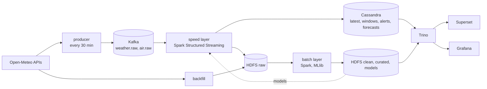
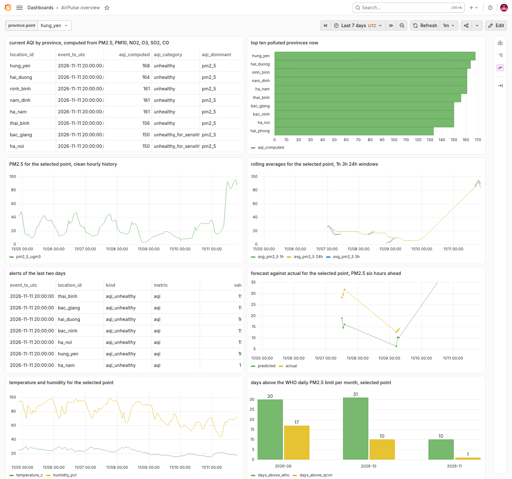
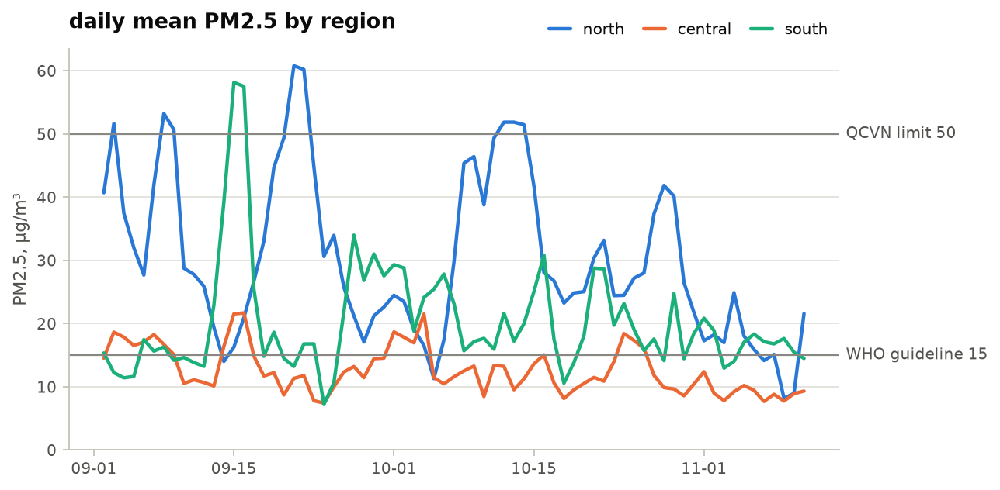

# AirPulse

Real time analysis and forecasting of weather and air quality trends for the provinces of Vietnam.
The project is the course assignment for Big Data Storage and Processing. It follows the lambda
architecture and runs on a local multi node Kubernetes cluster so that distribution, scalability
and fault tolerance can be exercised on a single machine.

## What the system does

- Collects hourly weather and air quality values (PM2.5, PM10, NO2, O3, CO, SO2, AQI, temperature,
  humidity, wind, rain) for 63 points, one per former province, every 30 minutes from the
  Open-Meteo APIs.
- Backfills hourly history for any range of days and can replay it at a configurable speed to
  generate load for benchmarks.
- Speed layer computes sliding window metrics, the current AQI, threshold and z score alerts and
  short term forecasts, and writes them to a realtime view within one to three minutes.
- Batch layer keeps raw, clean and curated datasets on HDFS, computes daily, monthly, seasonal and
  yearly tables, weather and pollution correlations, and trains a short term forecast model
  with Spark MLlib.
- A single SQL layer joins the batch views and the realtime view for dashboards.

## Architecture



| Layer | Technology | Role |
|---|---|---|
| Ingestion | Python producer as a Kubernetes Deployment, backfill as a Spark application | Call the APIs on a schedule and publish events to Kafka, load history into the raw layer |
| Messaging | Kafka in KRaft mode, 3 brokers | Topics `weather.raw`, `air.raw`, `weather.clean`, `air.clean`, `air.alerts` and replay topics |
| Speed layer | Spark Structured Streaming | Archive, clean, aggregate by window, detect anomalies, online forecast |
| Batch layer | Spark batch, Spark MLlib, one MapReduce style job | Trends, correlations, features, model training |
| Raw and batch storage | HDFS with Parquet, Hive Metastore | Raw, clean and curated layers partitioned by day |
| Realtime storage | Cassandra, 3 nodes | Latest values, windows, alerts and forecasts per point |
| Query | Trino | One SQL interface over the Hive and Cassandra connectors |
| Dashboards | Superset and Grafana | Analytics dashboards, realtime view and cluster monitoring |
| Monitoring | Prometheus and Grafana | Throughput, latency and resource usage during benchmarks |

The system runs on Open-Meteo, the forecast API for weather, the CAMS based API for air quality
and the ERA5 archive for older weather. Sources for OpenAQ station measurements and for
OpenWeatherMap are written against the same interface. They are switched on with an api key in
`.env` and their name in `ingestion.enabled_sources`, they have unit tests and have not run on
the cluster yet. Details are in `docs/data_sources.md`.

## Repository layout

```
configs/        non secret settings per profile (dev, demo, bench) and the province list
schemas/        data contracts, Kafka event schemas, Hive DDL, Cassandra CQL, Trino views
src/airpulse/   the python package, one subpackage per layer
  common/       config, logging, schemas, AQI formulas, Kafka helpers, time utilities
  ingestion/    api sources, producer, backfill, replay and history amplification
  streaming/    Spark Structured Streaming jobs, the speed layer
  batch/        Spark batch jobs, the batch layer
  mapreduce/    one job written in the MapReduce pattern for illustration
  ml/           baselines, training, evaluation, model registry on HDFS
  serving/      cassandra sink and registration of the datasets in the hive metastore
  analysis/     trino results as pandas frames, summaries and chart style for the notebooks
deploy/         kubernetes cluster definition, images, helm values, manifests and scripts
dashboards/     exported Superset and Grafana dashboards
notebooks/      exploration notebooks, committed without outputs
tests/          unit, integration, fault tolerance and benchmark tests
docs/           public documentation, architecture, data sources, runbook and results
```

Every job is a module with a `main` function and runs as
`python -m airpulse.<layer>.<job> --config configs/<profile>.yaml`. Nothing is hardcoded, every
host, port, path and topic comes from `configs/`. `base.yaml` holds the shared values, each
profile file extends it and overrides a few keys, and any environment variable named
`AIRPULSE_<section>__<key>` (nested keys joined with a double underscore, for example
`AIRPULSE_KAFKA__BOOTSTRAP_SERVERS`) overrides the merged result. Secrets only live in `.env`,
which is ignored by git, and in Kubernetes secrets.

## Getting started

Requirements on the host, Python 3.11, GNU make, a JDK 17 for running Spark locally, Docker,
and for the cluster kind, kubectl and Helm. `uv` is used when available, otherwise the standard
`venv` and `pip` are used. The makefile finds a JDK 17 under `/usr/lib/jvm` on its own.

```bash
cp .env.example .env
make setup
make check
```

`make help` lists every target. The cluster targets call the scripts under `deploy/scripts/`.

```bash
make cluster-up PROFILE=dev
make deploy PROFILE=dev
make port-forward PROFILE=dev
make demo PROFILE=dev
```

`make batch PROFILE=dev` runs the batch layer again, one job after the other. The nightly
schedules of the batch jobs are created suspended, a laptop that was off would otherwise start
every missed run at once. `make cluster-stop` and `make cluster-start` stop a cluster and bring
it back with its data, the speed layer resumes from its checkpoints.

The step by step procedure, including laptop runs of the jobs on local directories, is in
`docs/runbook.md`. The architecture and the reasons behind each component are in
`docs/architecture.md`, the sources and their quirks in `docs/data_sources.md`.

## Jobs

| Module | Layer | What it does |
|---|---|---|
| `airpulse.ingestion.producer` | ingestion | polls the sources and publishes raw events to Kafka |
| `airpulse.ingestion.backfill` | ingestion | loads the hourly history of a range of days into the raw layer |
| `airpulse.ingestion.replay` | ingestion | replays history into Kafka at a configurable speed |
| `airpulse.ingestion.amplify` | ingestion | copies the raw history back in time to build the benchmark volumes |
| `airpulse.streaming.speed_layer` | speed | archive, clean, windows, alerts and forecast queries |
| `airpulse.batch.raw_to_clean` | batch | exact rebuild of the clean layer |
| `airpulse.batch.trends` | batch | daily, monthly, seasonal, yearly tables and the heatmap |
| `airpulse.batch.correlations` | batch | weather and pollution correlations |
| `airpulse.batch.features` | batch | the forecast feature table |
| `airpulse.mapreduce.monthly_average` | batch | the monthly mean in the MapReduce pattern |
| `airpulse.ml.train` | ml | trains and evaluates the forecast models |
| `airpulse.ml.evaluate` | ml | compares stored models with the baselines |
| `airpulse.serving.register_tables` | serving | registers the datasets in the Hive metastore |

Every job runs as `python -m <module> --config configs/<profile>.yaml` and accepts `--input`
and `--output` overrides for local runs.

## Notebooks

`notebooks/01_eda_air_quality_and_weather.ipynb` explores the clean and curated tables, the
quality of the data, pollution by region, day and hour, the weather as a driver of PM2.5 and
the errors of the forecast models. It reads the tables through Trino and keeps every result as
a parquet file under `data/eda`, so it runs again while the cluster is stopped. Its charts are
in `docs/images` with the prefix `eda`.

```bash
make setup-notebook
make notebook
make notebook-run
```

`make notebook-run` writes html copies with output to `.cache/notebooks`. The notebooks in git
carry no output, `make notebook-clean` removes it. Taking a new extract is described in
`docs/runbook.md`.

## Results

Measured on the demo profile, one control plane and three workers on a laptop with 4 cores and
31 GiB of memory. Every node shares that CPU and disk, see `docs/results/readme.md`.

| Topic | Result | Details |
|---|---|---|
| Deployment | `make cluster-up` 40 s, `make deploy` 14 min 55 s, the whole demo scenario 22 min 20 s | `docs/results/demo_profile.md` |
| Data | 72 days of hourly values for 63 points, 136,512 raw rows per domain cleaned to 108,612, one per point and hour | `notebooks/01_eda_air_quality_and_weather.ipynb` |
| Batch scaling | 1, 5 and 10 years of history take 340 s, 1,248 s and 3,418 s with two executors, four executors are 3 percent faster than two | `docs/results/batch_scaling.md` |
| Stream | 1,402,272 events replayed in 124 s, the clean queries absorb about 13,000 events per second and more executors do not raise it | `docs/results/stream_scaling.md` |
| Trino | one aggregation over 5.5 million rows takes 35 to 39 s with one worker and 40 to 42 s with two | `docs/results/trino_scaling.md` |
| Fault tolerance | a broker deleted under 300,000 writes with acks all, none lost and none doubled, back in sync after 30 s. A datanode, a Cassandra node, an executor, the driver and a whole worker were removed and recovered | `docs/results/fault_tolerance.md` |
| Forecast | gradient boosted trees beat persistence by 7 and 29 percent for PM2.5 one and six hours ahead and lose 3 percent one day ahead | `docs/results/demo_profile.md` |





## Limits

- Everything runs on one machine. The scaling numbers show contention for four cores and one
  disk more than they show speedup.
- Open-Meteo is the only source that has run on the cluster.
- The demo cluster holds 72 days of history, from 2026-09-01. The seasonal and yearly tables
  stay thin until more is loaded, and the benchmarks use copies of those weeks shifted back in
  time.
- Air quality is model output on a coarse grid, the 63 points carry 53 distinct PM2.5 series.
- One day ahead the forecast model does not beat persistence.
- The namenode, the Hive metastore and the Trino coordinator run as single instances.

## Version matrix

| Component | Version |
|---|---|
| Python | 3.11 locally, 3.10 in the Spark image |
| Spark and PySpark | 3.5.9, Scala 2.12 connectors, Kafka connector 3.5.9, Cassandra connector 3.5.1 |
| Java for Spark | 17 |
| Kafka | Strimzi operator 1.3.x, api `kafka.strimzi.io/v1`, KRaft mode |
| Spark operator | kubeflow spark-operator chart 2.5.x |
| Hadoop HDFS | 3.4.3 |
| Hive metastore | 3.1.3 with embedded Derby |
| Cassandra | 4.1 |
| Trino | chart 1.45.x, Trino 484 |
| Superset | chart 0.x, Superset 6.1 |
| Monitoring | kube-prometheus-stack, Grafana with the trino-datasource plugin |
| Kubernetes | kind 0.33, Kubernetes 1.37 |
